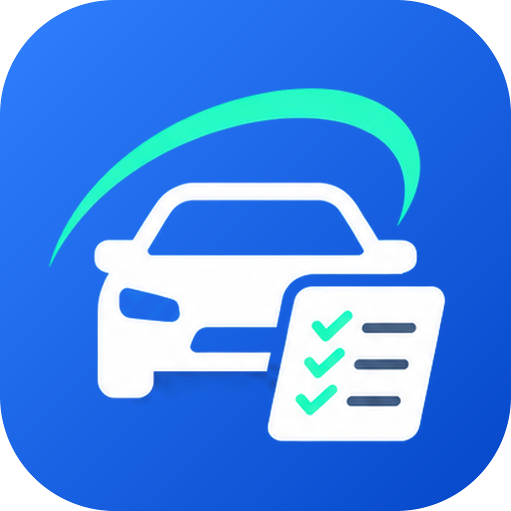
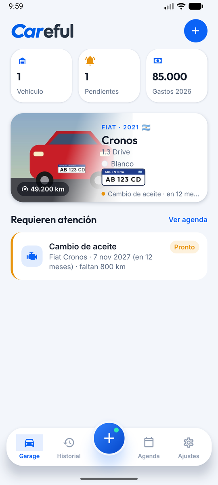
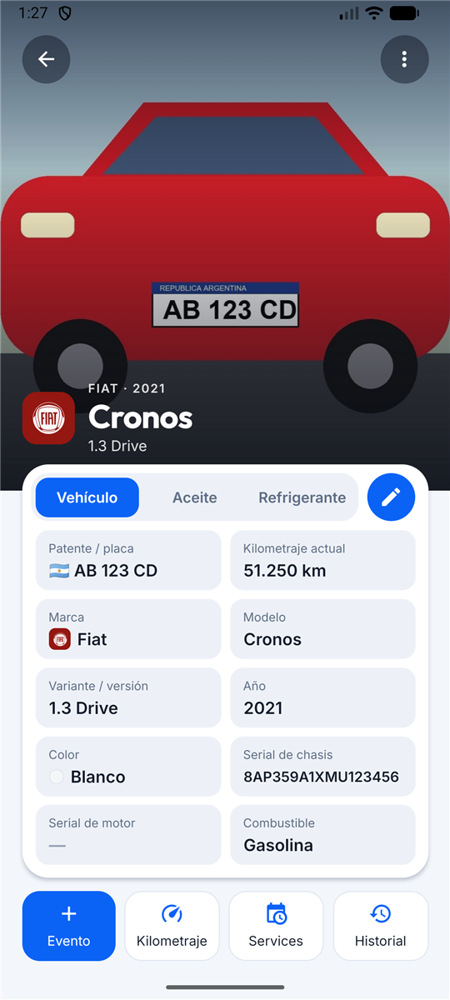
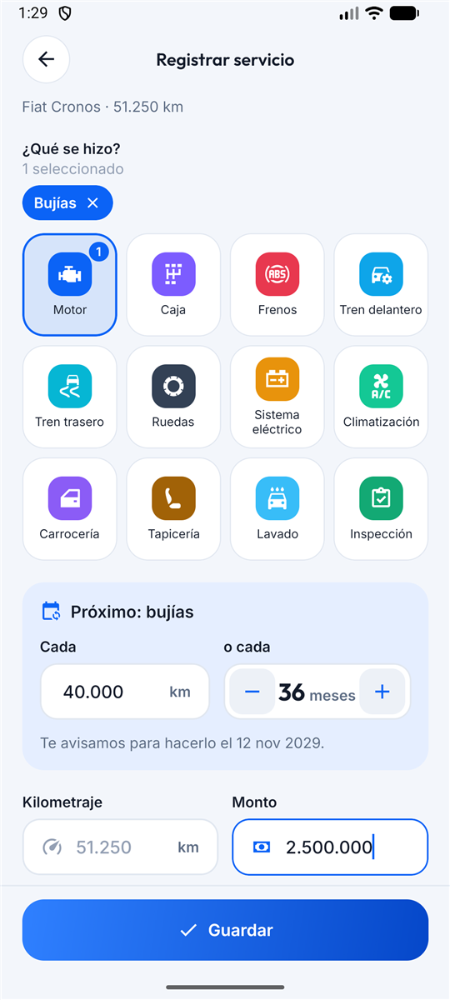
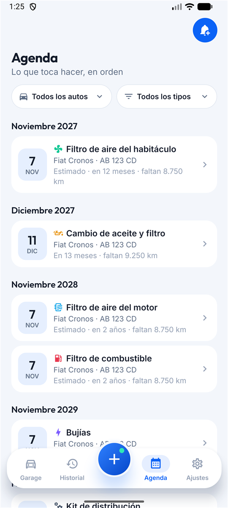

<p align="center">
  
</p>

<p align="center">
  <picture>
    <source media="(prefers-color-scheme: dark)" srcset="assets/images/wordmark-dark.png" />
    
  </picture>
</p>

<h3 align="center">Tu auto, toda su historia en un solo lugar.</h3>

<p align="center">
  Bitácora vehicular para Android: mantenimientos, reparaciones, accesorios, kilometraje y gastos,<br/>
  con avisos inteligentes antes de cada service. 100 % local, con respaldo e IA.
</p>

<p align="center">
  
  
  
  
  
  <a href="LICENSE"></a>
</p>

---

**Careful** (juego de palabras entre *cuidado* y *Car*-eful) es una app para llevar la **historia completa de tus vehículos**: cada service, reparación, accesorio y kilómetro, con fotos y montos. Con esa historia calcula **cuándo toca el próximo mantenimiento, por kilómetros o por fecha (lo que ocurra primero)** y te avisa a tiempo. Y cuando vendas el auto, exportás todo su historial en PDF.

<p align="center">
  
  
  
  
</p>

## ✨ Funcionalidades

### 🚗 Garage
- Tarjetas grandes por auto: foto con **degradado diagonal**, marca, modelo, color, **patente estilo Mercosur** y **bandera del país**.
- Resumen: vehículos, services que requieren atención y gastos del año.
- Detalle por vehículo: kilometraje, uso promedio, próximos services con barra de progreso, ficha técnica e historial.

### 🧭 Alta de vehículo (asistente de 4 pasos, sin scroll)
1. **Tu auto** — foto + **marca → año → modelo → versión → color**, con el catálogo del mercado argentino: **88 marcas, unos 1.000 modelos y unas 11.500 versiones de 1997 a 2026**, tomados de las listas de la CCA ([detalle](docs/CATALOG.md)). Elegís marca y año y aparecen solo los modelos de ese año, y después sus versiones. «Otro modelo» permite escribirlo a mano si no está.
2. **Registro** — patente, país, **kilometraje actual**, VIN (validado y decodificado), N° de motor y combustible (GNC, gasolina o diésel).
3. **Aceite** — tipo, marca, modelo, versión, cantidad y **cada cuántos km y meses se cambia**.
4. **Refrigerante** — tipo, cantidad, concentración (con el cálculo de refrigerante + agua desmineralizada), marca, modelo y versión.

En los pasos 3 y 4, **«Investigar con IA»** busca en internet los datos del fabricante para ese año, motor y versión, y muestra las fuentes.

IA en el alta: **escanear la cédula verde** completa los datos, y la **foto del auto** detecta patente y color.

### 🔧 Registro de actividad (botón ＋ central)
- **Servicio / Mantenimiento**: «¿Qué se hizo?» con las categorías (Motor, Caja, Frenos, Tren delantero, Ruedas, Sistema eléctrico, Climatización, Lavado…) y sus tareas; se pueden elegir varias. Las tareas del plan de mantenimiento piden **cada cuántos km y meses toca la próxima**, precargado con el plan del auto. La ficha del auto lo abre con **＋ Evento**.
- **Accesorios**: panel rápido con título, descripción, monto, km y foto.
- **Kilometraje**: panel rápido con el km actual y una descripción.
- Km (validado contra el historial), monto **sin símbolo de moneda**, descripción con **"Mejorar texto"**, taller y foto opcional.

### 📅 Agenda inteligente
- **Plan de mantenimiento** (editable por vehículo): cambio de aceite y filtro, filtro de aire del motor, filtro de aire del habitáculo, filtro de combustible, bujías y kit de distribución. Cada uno agenda el **próximo service por km o por fecha, lo que ocurra primero**, desde el primer día (estimado hasta que lo registres).
- Como no hay odómetro en vivo, el vencimiento por km se convierte en una **fecha estimada según tu uso promedio**.
- **Lista cronológica**: vencidos primero y después mes por mes, con **filtros por auto y por tipo**. Incluye los recordatorios manuales (seguro, patente, VTV…).

### 🔔 Notificaciones
- **Cada semana** desde que faltan **1.000 km o un mes** (lo que llegue primero) **hasta que registres el servicio**, aunque ya esté vencido.
- **Mañana** y **Hoy** el día del vencimiento, y un aviso inmediato al cargar un km que deja menos de 1.000 km.
- Registrar el servicio borra los avisos anteriores y agenda el próximo desde ese día y ese km.
- Recordatorio para actualizar el kilometraje.

### 🔐 Seguridad y privacidad
- **PIN** propio o **desbloqueo del teléfono** (huella / rostro / PIN del equipo).
- Se bloquea al salir y al volver pide desbloqueo directo, sin diálogos previos.
- **Sin cuentas ni servidores**: los datos viven en tu teléfono.

### ☁️ Respaldo y sincronización
- **Siempre automático**: una copia `.zip` (datos + fotos) **después de cada cambio** (una sola aunque hagas varios seguidos) y **una por día después de la medianoche**. Se conservan las 5 más recientes y una por día de las últimas 2 semanas.
- **Nube (Google Drive)**: carpeta «Careful Respaldos», **solo con Wi-Fi** o también con datos móviles, y restauración desde la lista de copias.
- Permiso mínimo `drive.file`: Careful solo ve los archivos que crea.
- **Copia de seguridad de Android** (Google One) con reglas propias.
- **Local**: carpeta del teléfono, **compartir** una copia por cualquier app y **restaurar** desde archivo.
- 👉 Cómo funciona y cómo configurarlo: [docs/GOOGLE-DRIVE.md](docs/GOOGLE-DRIVE.md).

### 🤖 Inteligencia artificial — dos motores, una interfaz
| | En el teléfono | Gemini (nube) |
|---|---|---|
| Costo | Gratis | Clave gratuita de Google AI Studio |
| Conexión | Offline | Requiere internet |
| Cédula y patente | OCR con ML Kit + parser propio | Visión multimodal |
| Fluidos | Catálogo offline | «Investigar con IA»: búsqueda web con fuentes fiables (manual, fabricante, lubricantes) |
| Mejorar texto | Reglas de estandarización | Redacción técnica |

En modo **Automático** usa Gemini si está configurado y cae a la IA local si no hay conexión.

### 📄 Más
- Historial completo agrupado por mes, con **filtros por auto y por tipo** (servicio, accesorios, kilometraje).
- **Informe del vehículo en PDF** para la venta: resumen (km recorridos, gastos por rubro, costo por km, servicios), ficha técnica, estado de cada servicio e historial detallado con fotos.
- Archivar vehículos vendidos sin perder su historia.
- Tema **automático / claro / oscuro** (automático por defecto).

## 🧠 Decisiones de producto

La idea original se revisó punto por punto. Algunos ajustes: chasis y carrocería son el mismo dato (VIN) y se agregó el N° de motor; el km actual pasa a ser obligatorio en el alta; el "＋" tiene un acceso directo a "solo kilometraje"; se agregó la categoría **frenos**; el bloqueo no se dispara al usar la cámara; y los avisos que caen el mismo día se unifican.
👉 Detalle completo en [docs/LOGIC-REVIEW.md](docs/LOGIC-REVIEW.md).

## 🏗️ Arquitectura

```
src/
├── app/         Pantallas (Expo Router): tabs, vehículo, registro, recordatorios, ajustes
├── components/  UI reutilizable
├── data/        Catálogo de vehículos (JSON por marca)
├── db/          SQLite: migraciones, repositorios, snapshot de respaldo
├── domain/      Lógica pura: agenda, notificaciones, VIN, patentes, parser de cédula
├── services/    Fotos, notificaciones, respaldo y Google Drive, IA, PDF, seguridad
└── theme/       Tokens de diseño (claro/oscuro)
modules/
└── careful-google-auth/   Módulo nativo (Kotlin): autorización de Google para Drive
```

- **Offline-first** con SQLite y migraciones versionadas.
- **Lógica de dominio pura** y testeada; los repositorios se prueban contra **SQLite real** (`node:sqlite`).
- IA detrás de una interfaz `AiProvider` (nube y local intercambiables).

👉 Más en [docs/ARCHITECTURE.md](docs/ARCHITECTURE.md).

## 🚀 Empezar

Requisitos: Node.js 22+, Android SDK (Android Studio) y JDK 17+.

```bash
git clone https://github.com/miguelazocar/Careful-App.git
cd Careful-App
npm install
npm run check            # typecheck + lint + tests
npx expo run:android     # compila e instala en un emulador o teléfono
```

APK de release firmado (Windows):

```powershell
.\scripts\build-apk.ps1
```

👉 Guía completa (firma, EAS, versionado) en [docs/BUILD.md](docs/BUILD.md).

## 🗺️ Roadmap

IA on-device con Gemini Nano, cargas de combustible, vencimientos de documentación, transferencia del historial a un nuevo dueño, widgets e iOS.
👉 [docs/ROADMAP.md](docs/ROADMAP.md)

## 🎨 Identidad

Ícono, wordmark y paleta en [docs/brand/](docs/brand/). Los assets de la app se generan con `python scripts/generate-brand-assets.py`.

| Azul Careful | Menta | Tinta |
|---|---|---|
| `#0B63F6` | `#2EE8B6` | `#1D2633` |

## 📄 Licencia

[MIT](LICENSE) © 2026 Miguel Angel Azocar. Podés usar, modificar y distribuir el código libremente, manteniendo el aviso de copyright.

## 👤 Autor

**Miguel Angel Azocar** — [@miguelazocar](https://github.com/miguelazocar)

---

<sub>Los datos técnicos del catálogo (capacidades de aceite y refrigerante) son de referencia; verificá siempre el manual de tu vehículo. Marcas y modelos mencionados pertenecen a sus respectivos dueños y se usan solo para identificar vehículos. Los logos de marcas provienen de [Simple Icons](https://simpleicons.org) (CC0) y se muestran solo con ese fin.</sub>
