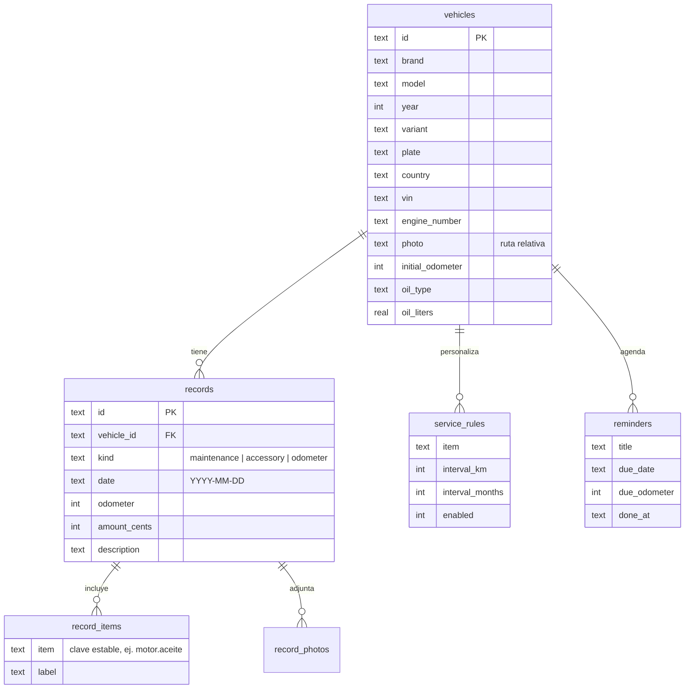

# Arquitectura

Careful es una app **offline-first**: todo vive en una base SQLite en el teléfono. No hay servidor.

## Stack

| Capa | Tecnología |
|---|---|
| App | React Native 0.88 + **Expo SDK 58** (New Architecture, React Compiler) |
| Navegación | Expo Router (rutas por archivo en `src/app/`) |
| Datos | `expo-sqlite` con migraciones propias (`PRAGMA user_version`) |
| Estado | Zustand (ajustes, bloqueo, toasts) + un hook `useQuery` que se refresca con cada escritura |
| Archivos | `expo-file-system` (API nueva: `File`, `Directory`, SAF) |
| Notificaciones | `expo-notifications` (locales, programadas) |
| Segundo plano | `expo-background-task` (WorkManager) |
| Seguridad | `expo-local-authentication`, `expo-secure-store`, `expo-crypto` |
| IA local | `expo-text-extractor` (ML Kit OCR) + reglas |
| IA nube | Gemini API (REST) |
| Tests | Jest + `node:sqlite` (los repositorios se prueban contra SQLite real) |

## Estructura

```
src/
├── app/                 Pantallas (Expo Router)
│   ├── (tabs)/          Garage · Historial · Agenda · Ajustes (+ botón central)
│   ├── vehicle/         Wizard de alta/edición, detalle y plan de mantenimiento
│   ├── record/          Formulario y detalle de registros
│   ├── reminder/        Recordatorios manuales
│   └── settings/        Seguridad, respaldo, notificaciones, IA, acerca de
├── components/          UI reutilizable (primitivas, tarjetas, tab bar, lock screen…)
├── data/catalog/        Catálogo de vehículos (JSON por marca) + consultas
├── db/                  Conexión, migraciones, repositorios, snapshot de respaldo
├── domain/              Lógica pura y testeable (agenda, notificaciones, VIN, patentes…)
├── hooks/               useQuery
├── lib/                 Fechas, formato numérico y cliente REST de Google Drive
├── services/            Efectos: fotos, notificaciones, respaldo y Drive, IA, PDF, seguridad
├── stores/              Zustand (ajustes persistidos, UI)
└── theme/               Tokens de diseño y ThemeProvider
modules/                 Módulos nativos locales (careful-google-auth: autorización de Google en Kotlin)
plugins/                 Config plugins (Auto Backup de Android, firma de release, CMake en Windows)
scripts/                 Generación de assets de marca y build del APK
```

**Regla de dependencias:** `domain/` y `lib/` no importan nada de Expo ni de React Native → son 100 % testeables. `db/` depende solo de una interfaz `Db` mínima, que en la app implementa `expo-sqlite` y en los tests `node:sqlite`.

## Modelo de datos



- IDs UUID (preparados para sincronización futura).
- Fechas de calendario como `YYYY-MM-DD` locales (sin problemas de zona horaria).
- Montos en centavos enteros, sin moneda.
- Fotos con ruta relativa a `documents/` → los respaldos son portables.
- Borrado en cascada: eliminar un vehículo borra sus registros, fotos, reglas y recordatorios.

## Motor de agenda (`src/domain/schedule.ts`)

1. Para cada vehículo se toma la **última ocurrencia** de cada ítem (`getLatestItemOccurrences`).
2. Se resuelve el intervalo: regla del vehículo si existe, si no el valor por defecto del catálogo de mantenimiento.
3. `dueDate = fecha + meses`, `dueKm = km + intervalo`.
4. El **uso diario** se estima con las lecturas de odómetro de los últimos 12 meses (mínimo 2 lecturas en 14 días).
5. `kmDate = hoy + kmRestantes / usoDiario`; la **fecha efectiva** es la menor entre `dueDate` y `kmDate` ("lo que ocurra primero").
6. Estado: `overdue` (vencido), `soon` (≤ 30 días o ≤ 1.000 km), `ok`.

Las notificaciones (`src/domain/notification-plan.ts`) se derivan de esa lista y se **reprograman completas** (idempotente) después de cada cambio de datos, al abrir la app y desde la tarea en segundo plano.

## IA

```
AiProvider (interfaz)
├── geminiProvider   → REST generativelanguage.googleapis.com (clave del usuario en SecureStore)
└── localProvider    → ML Kit OCR + parsers + catálogo + reglas
runAi(task)          → usa el preferido y cae al local si la nube no está configurada o no hay red
```

## Respaldo

- Formato: `.zip` con `careful-backup.json` (todas las tablas, columnas crudas) + `photos/*.jpg`.
- La restauración valida formato y versión, reemplaza los datos en **una transacción** y cambia la carpeta de fotos solo si la importación salió bien.
- Ajustes ligados al dispositivo (`securityMode`, `backup`, `drive`, `ai`) nunca viajan.
- Destinos automáticos: **Google Drive** (carpeta «Careful Respaldos», permiso `drive.file`) y **carpeta del teléfono** (SAF). El zip se arma una sola vez por ejecución; "Solo con Wi-Fi" deja la subida pendiente hasta que haya red permitida. Ver [GOOGLE-DRIVE.md](GOOGLE-DRIVE.md).
- Auto Backup de Android: `plugins/with-android-backup-rules.js` incluye `files/SQLite/` y excluye SecureStore y fotos.

## Seguridad

- PIN: SHA-256 iterado con sal, en `expo-secure-store` (Android Keystore).
- Bloqueo al pasar a segundo plano, salvo actividades del sistema abiertas por la app (`withExternalActivity`).
- La clave de Gemini se guarda cifrada y solo se envía a Google.
